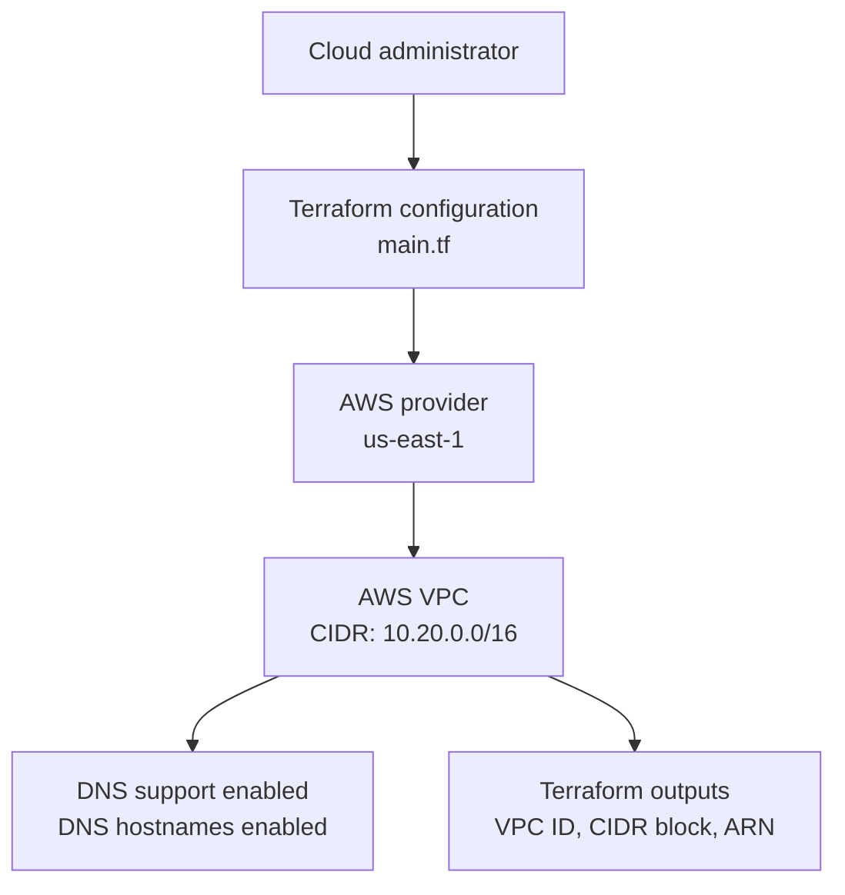
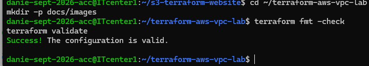

# AWS VPC Lab with Terraform

## Project Overview

This project demonstrates how to define an Amazon Virtual Private Cloud
(VPC) using Terraform. It is a foundational Infrastructure as Code lab
for learning AWS networking and cloud system administration.

## AWS Resources

The current Terraform configuration defines one AWS VPC.

- Region: us-east-1 (Northern Virginia)
- VPC CIDR block: 10.20.0.0/16
- DNS support: Enabled
- DNS hostnames: Enabled

The VPC includes these tags:

- Name: terraform-vpc-lab
- Environment: learning
- ManagedBy: Terraform

## Technology Stack

- Amazon Web Services (AWS)
- Amazon VPC
- Terraform
- HashiCorp AWS provider
- Ubuntu Linux CLI

## Repository Contents

- `main.tf` — Terraform configuration for the VPC and its outputs
- `.terraform.lock.hcl` — records selected provider dependencies
- `.gitignore` — excludes local Terraform state, credentials, and working files
- `README.md` — project documentation

## Terraform Outputs

The configuration defines these outputs:

- `vpc_id` — ID of the VPC
- `vpc_cidr_block` — IPv4 address range assigned to the VPC
- `vpc_arn` — Amazon Resource Name of the VPC

## Prerequisites

- Terraform 1.5.0 or newer
- An AWS account with permissions to manage VPC resources
- AWS credentials configured securely outside this repository
- The AWS provider version permitted by `main.tf`

## Validate the Configuration

Initialize Terraform:

    terraform init

Format-check the configuration:

    terraform fmt -check

Validate the configuration:

    terraform validate

Preview planned changes:

    terraform plan

To create the resources, run `terraform apply` only after reviewing
the plan and confirming that you intend to create the VPC.

## Cleanup and Cost Awareness

Review the Terraform plan before creating or destroying resources.
If you create resources in a fresh working directory, Terraform will
use that directory's state file to track them.

Do not delete resources manually or run `terraform destroy` unless
you understand which resources the current state manages.

## Current Scope and Future Improvements

This is a foundational VPC lab. It currently defines a VPC only;
it does not define subnets, internet gateways, route tables, NAT
gateways, or security groups.

Possible future improvements include:

- Public and private subnets
- Route tables and internet gateway
- Security groups with least-privilege rules
- Input variables for region and CIDR block
- Reusable Terraform modules
- Automated validation with a CI/CD pipeline

## Security

- Do not commit AWS access keys, secret keys, or private SSH keys.
- Do not commit Terraform state files or secret variable values.
- Keep AWS credentials outside the repository.

## Architecture Diagram

This diagram represents the resources defined in Terraform. It describes the intended configuration, not proof that a VPC has been deployed in AWS.

## Validation Screenshot

This screenshot shows the Terraform formatting and configuration validation results. Validation does not prove that resources have been deployed in AWS.
