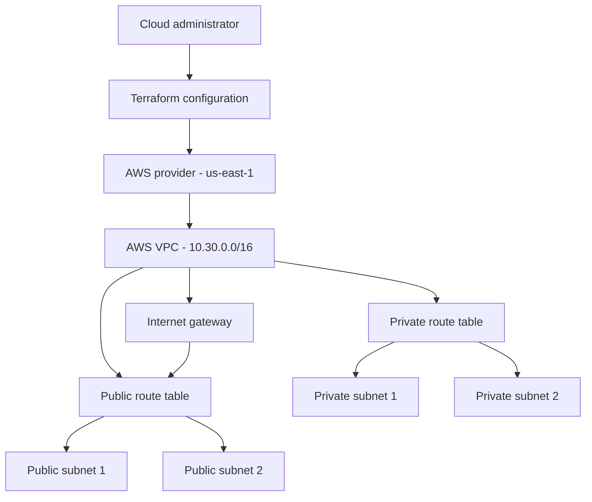

# Advanced AWS VPC Lab with Terraform

## Project Purpose

This project demonstrates how to define a reusable AWS network foundation using Terraform. It extends the foundational VPC lab with public and private subnets, an internet gateway, route tables, variables, tags, and outputs.

The configuration describes intended infrastructure. This README alone does not prove that the resources have been deployed in AWS.

## Architecture Diagram

## Resources Defined

The default configuration uses the AWS `us-east-1` Region and VPC CIDR block `10.30.0.0/16`.

- One VPC with DNS support and DNS hostnames enabled.
- One internet gateway attached to the VPC.
- Two public subnets across two Availability Zones by default.
- Two private subnets across the selected Availability Zones.
- One public route table with a default IPv4 route to the internet gateway.
- One private route table without a configured default internet route.
- Route table associations for both subnet groups.
- Common resource tags for the project, environment, and Terraform management.

The `availability_zone_count` variable supports two or three Availability Zones.

## Public and Private Subnets

Public subnets have public IPv4 address assignment enabled on launch. Their route table directs default IPv4 traffic to the internet gateway. This does not automatically make an application secure or guarantee that an instance is reachable.

Private subnets use a route table without a configured default internet route. No NAT gateway is defined, so this configuration does not provide a NAT-based outbound internet path for private workloads.

## Repository Contents

- `main.tf` — VPC, subnets, internet gateway, route tables, and associations.
- `variables.tf` — Region, resource name prefix, VPC CIDR, and Availability Zone count.
- `outputs.tf` — VPC, internet gateway, subnet, and route table identifiers.
- `.terraform.lock.hcl` — selected provider dependency versions.
- `README.md` — project documentation and architecture diagram.

## Validation

Run the following commands from the `advanced` directory, after initializing Terraform if necessary:

- `terraform init` — initializes the working directory and downloads provider dependencies.
- `terraform fmt -check` — checks Terraform formatting.
- `terraform validate` — checks configuration syntax and internal consistency.
- `terraform plan` — previews proposed infrastructure changes.

Validation does not prove deployment. Review the plan carefully before considering `terraform apply`.

## Security and Limitations

- Never commit Terraform state files, credentials, private keys, or secret variable files.
- Keep AWS credentials outside the repository.
- This configuration does not define NAT gateways, EC2 instances, custom security groups, or application workloads.
- Route tables are one part of network security; they do not replace identity permissions or other network controls.

## Cost and Cleanup

Creating AWS resources can incur charges. Review planned changes before applying them. Before cleanup, confirm which resources are managed by the working directory's Terraform state.

Do not run `terraform destroy` unless you have verified which resources the current state manages and intend to delete them.

## Project Status

This document describes the Terraform configuration. Record validation results and deployment status separately using actual command output and AWS evidence. Do not claim resources were deployed unless deployment has been verified.
